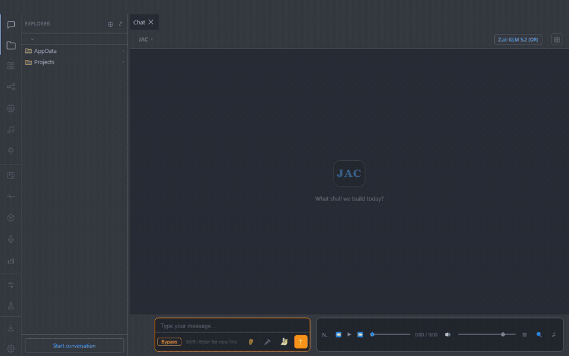
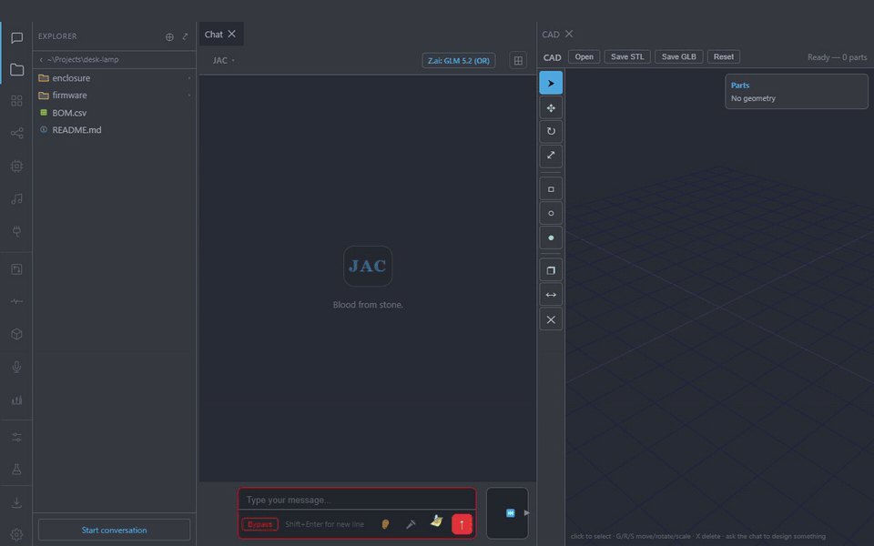
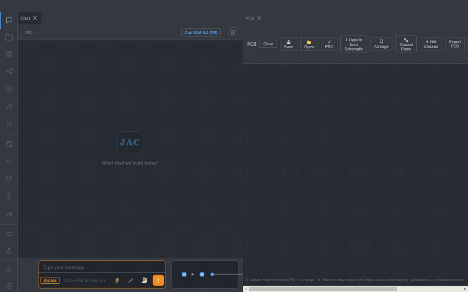

<p align="center">
  
</p>

<h1 align="center">JAC — AI Workbench</h1>

<p align="center">
  A desktop workbench where an AI agent can search, code, run tools, design 3D parts and circuit boards, and talk back — in one app.
</p>

<p align="center">
  <a href="https://github.com/Clifford-Swartz/jac-desktop-releases/releases/latest"><b>Download for Windows</b></a>
  &nbsp;·&nbsp; <a href="#features">Features</a>
  &nbsp;·&nbsp; <a href="#architecture">Architecture</a>
  &nbsp;·&nbsp; <a href="#build-from-source">Build from source</a>
</p>

<p align="center">
  
  <br><sub>Asked what changed in the latest Electron release, JAC queries GitHub, asks permission for each new tool, and summarizes the release notes.</sub>
</p>

JAC started as a VS Code extension and grew into a standalone Electron app. It works with any model on
[OpenRouter](https://openrouter.ai) or a local model (llama.cpp / Ollama), gives it real tools through the
[Model Context Protocol](https://modelcontextprotocol.io), and adds purpose-built workspaces for CAD, PCB
design, and voice. The installer auto-updates.

## Features

### Agentic chat
- Tool-calling loop that streams text, runs tools, and feeds results back, for up to 50 steps per turn.
- Recovers when a reply is cut off or the model announces an action without taking it, instead of stopping silently.
- Long conversations are compacted into a *Goal / Done / Learned / Failed / Open* summary rather than failing on context overflow.
- Works with cloud models (OpenRouter) and local GGUF models, including speculative decoding with a draft model.

### Built-in tools
| Tool | What it does |
|---|---|
| Web search / fetch | Multiple search engines with per-engine cooldowns; a rate-limited engine reports an error instead of "no results" |
| Offline Wikipedia | A full local dump served by kiwix: ~185 ms search, ~13 ms article reads, no network |
| Recall | Full-text search over JAC's own saved conversations (~51 ms across 7.7k messages) |
| GitHub | Read-only access through the user's own `gh` CLI, so JAC never handles a token |
| Shell | Run commands or background processes, with output caps so a huge file can't flood the chat |
| Screenshot | Capture the screen or a single window into the chat |

### MCP tool servers
- Hand-written stdio JSON-RPC MCP client with a multi-server manager (same config shape as Claude Desktop).
- Add, list, and remove servers by asking in chat; every tool is permission-gated (*allow / ask / deny*).

### Voice
- Hands-free: say **"hey Jac"**, speak, and hear the reply. Two Whisper tiers: `tiny.en` (~450 ms) listens for
  the wake word, `small.en` (~2.7 s) transcribes the request.
- Push-to-talk by double-pressing an earbud, which keeps Bluetooth headphones in high-quality audio mode
  instead of the tinny headset profile an always-open mic forces.

<!-- GIF: docs/media/voice.gif — "hey Jac", a question, the spoken reply -->

### CAD and PCB design
- **CAD:** three.js viewer with move/rotate/scale gizmos, backed by a [build123d](https://github.com/gumyr/build123d) geometry server.
  The model writes the geometry code; JAC runs it and renders the part.
- **PCB:** schematic editor with a component library, automatic footprint placement, A\* auto-routing, and KiCad export.

<p align="center">
  
  <br><sub>CAD: a 40 × 20 × 3 mm bracket with two M3 holes and a 25 mm flange, from one sentence. The model fixes its own build123d error along the way.</sub>
</p>

<p align="center">
  
  <br><sub>PCB: an ESP32-S3 LED driver board placed, wired into four nets, auto-arranged, and auto-routed.</sub>
</p>

### Workspace
- Draggable, splittable tabs (dockview) for chat and every tool view, a file explorer, and a CodeMirror editor.
- Per-project chat history, with Claude Code sessions for the same folder stitched into one thread.
- A Setup tab that detects optional dependencies (Python, build123d, KiCad, Ollama, ffmpeg, local models)
  and installs them on demand, or lets the model walk you through it in chat.
- Experimental views: behavior steering for local models (control vectors), a Vesuvius Challenge scroll reader, and more.

## Architecture

```
┌──────────────────── JAC Desktop (Electron + TypeScript) ────────────────────┐
│  Renderer: chat · editor · CAD · PCB · models · MCP · voice · setup          │
│  Main:     agent loop · MCP manager · built-in tools · config · auto-update  │
└──────┬────────────────┬──────────────────┬──────────────────┬───────────────┘
       │ HTTPS          │ stdio (JSON-RPC)  │ HTTP (localhost)  │ WebSocket (optional)
       ▼                ▼                   ▼                   ▼
  OpenRouter /     MCP servers         Python tool servers    Relay ──► bridges on other
  local llama.cpp  (filesystem,        CAD :5050 (build123d)          machines (Claude Agent SDK),
  / Ollama         playwright, …)      PCB :5051 (KiCad)              VS Code extension, phone app
```

| Folder | Contents |
|---|---|
| [`desktop/`](desktop) | The Electron app: `src/main` (agent loop, MCP, tools, voice) and `src/renderer` (UI views) |
| [`extension/`](extension) | The original VS Code extension, plus a native audio helper in Rust (Windows/macOS) and Swift (macOS) |
| [`server/`](server) | Python services: CAD and PCB tool servers, local model manager, Claude Agent SDK bridge |
| [`relay/`](relay) | WebSocket relay that routes between clients and provider machines, with QR device pairing |

## Build from source

Requirements: Node.js 20+, and Python 3.11+ for the CAD/PCB tool servers.

```bash
cd desktop
npm install
npm run build
npm start
```

Optional tool servers (the app starts them automatically when their dependencies are installed):

```bash
pip install -r server/requirements.txt
pip install build123d          # CAD
```

To build the installer: `npm run dist` (electron-builder).

## Configuration

Settings live in `~/.jac/config.json`, which is never committed. Start from
[`desktop/config.example.json`](desktop/config.example.json), or just launch the app: it asks for an
OpenRouter key the first time you chat. The key can also come from the `OPENROUTER_API_KEY` environment
variable.

The relay is off by default. If you run your own, set its `AUTH_TOKEN` environment variable; the relay
refuses every connection when no token is set.

## Tech stack

TypeScript · Electron · webpack · dockview · CodeMirror · three.js · Python · build123d · KiCad ·
Whisper · llama.cpp · Model Context Protocol · WebSockets · Rust · Swift

## Contributors

- [Clifford Swartz](https://github.com/Clifford-Swartz)
- [@erichsbit](https://github.com/erichsbit)

## License

[MIT](LICENSE)
